# Awesome Project Management & Kanban 🚀📋

<div align="center">
  
</div>

<div align="center">
  <a href="https://github.com/ishandutta2007/Awesome-Awesome-Awesome"></a><a href="https://discord.gg/jc4xtF58Ve"></a> <a href="https://github.com/ishandutta2007/Awesome-Project-Management-Kanban/stargazers"></a> <a href="https://github.com/ishandutta2007/Awesome-Project-Management-Kanban/network/members"></a> <a href="https://github.com/ishandutta2007/Awesome-Project-Management-Kanban/blob/main/LICENSE"></a> <a href="https://github.com/ishandutta2007/Awesome-Project-Management-Kanban/pulls"></a> <a href="https://github.com/ishandutta2007"></a>
</div>

---

### 🌟 Top Project Management & Kanban Tools Ecosystem

> **A rigorously curated directory of category-leading SaaS platforms and open-source self-hosted solutions for Agile, Scrum, Kanban, and workflow orchestration.**  
> *Targeted for software engineering leads, project managers, homelab enthusiasts, and privacy-conscious organizations.*

---

## 📑 Table of Contents
- [📊 Sector Overview & Market Dynamics](#-sector-overview--market-dynamics)
- [💼 SaaS & Enterprise Hosted Platforms](#-saas--enterprise-hosted-platforms)
- [⭐ Open-Source GitHub Projects (Sorted by Stars)](#-open-source-github-projects-sorted-by-stars)
- [🎯 Decision Matrix: Choosing the Right Tool](#-decision-matrix-choosing-the-right-tool)
- [🤝 How to Contribute](#-how-to-contribute)
- [⭐ Star History](#-star-history)
- [💖 Support & Sponsoring](#-support--sponsoring)
- [⚖️ Disclaimer & License](#️-disclaimer--license)

---

## 📊 Sector Overview & Market Dynamics

- **Global Market Size & Rapid Expansion:** The global project management and collaborative work software market is valued at approximately **$8.5 Billion to $9.6 Billion in 2025–2026** and is forecast to exceed **$20.4 Billion by 2033–2036**, accelerating at a strong Compound Annual Growth Rate (**CAGR of 12.5%–15.4%**). Key growth catalysts include distributed workforce coordination, AI-driven sprint forecasting, and integrated workflow automation.
- **Market Structure & Fragmentation Dynamics:** The sector is **moderately fragmented** rather than a winner-take-all monopoly. While enterprise tech behemoths like Atlassian (Jira, Trello), Monday.com, and Microsoft capture the lion's share of corporate procurement budgets, continuous market bifurcation thrives. Developer-centric high-velocity tools (Linear), all-in-one workspaces (Notion, ClickUp), and self-hosted, privacy-first open-source powerhouses (Plane, AppFlowy, WeKan) capture massive organic adoption, preventing single-vendor dominance.

---

## 💼 SaaS & Enterprise Hosted Platforms

The table below lists leading proprietary project management and Kanban platforms, **sorted descending by company valuation / market capitalization**. All pricing tiers and free plan allowances reflect verified starting figures.

| 🏢 Platform & Provider | 📈 Company Size (Valuation / Revenue) | 🏷️ Starting Paid Tier | 🎁 Free Tier Limits & Trial Policy | 🎯 Core Workflows & Best For |
| :--- | :--- | :--- | :--- | :--- |
| **[Jira Software](https://www.atlassian.com/software/jira)** <br> *(Atlassian)* | **~$48.0 Billion** Market Cap <br> `~$4.4B ARR (NASDAQ: TEAM)` | **$7.75** / user / mo <br> *(Standard, annual billing)* <br> or $8.15 / user / mo monthly | **Free forever for up to 10 users**; includes 2 GB cloud storage, Scrum & Kanban boards, backlog management, and community support. | **The industry standard for Agile software teams**, sprint cycles, bug tracking, and release management. |
| **[Trello](https://trello.com/)** <br> *(Atlassian)* | **~$48.0 Billion** Parent Cap <br> `Acquired for $425M by Atlassian` | **$5.00** / user / mo <br> *(Standard, annual billing)* <br> or $6.00 / user / mo monthly | **Free forever for unlimited users**; up to 10 workspace boards, unlimited cards, unlimited Power-Ups, 10 MB per file, 250 automation runs/mo. | **Pioneer of simple visual Kanban**; ideal for lightweight personal workflows and small teams needing zero setup. |
| **[Monday.com](https://monday.com/)** <br> *(monday.com Ltd.)* | **~$14.0 Billion** Market Cap <br> `~$840M+ ARR (NASDAQ: MNDY)` | **$9.00** / seat / mo <br> *(Basic, annual; 3-seat min = $27/mo)* <br> or $12.00 / seat / mo monthly | **Free forever for up to 2 seats**; includes 3 project boards, unlimited docs, 200+ templates, 20+ column types, and 500 MB cloud storage. | **Modular Work OS** with custom visual databases, team dashboards, and cross-departmental automations. |
| **[Notion Projects](https://www.notion.com/)** <br> *(Notion Labs, Inc.)* | **~$10.0 Billion** Valuation <br> `~$300M+ ARR (Private)` | **$10.00** / user / mo <br> *(Plus, annual billing)* <br> or $12.00 / user / mo monthly | **Free forever for individual users** (unlimited pages and blocks); up to 10 guest collaborators, 5 MB file uploads, and 7-day page history. | **Unified workspace** integrating project roadmaps, Kanban cards, team wikis, and relational docs. |
| **[ClickUp](https://clickup.com/)** <br> *(Mango Technologies)* | **~$4.0 Billion** Valuation <br> `~$200M+ ARR (Private)` | **$7.00** / user / mo <br> *(Unlimited, annual billing)* <br> or $10.00 / user / mo monthly | **Free forever for unlimited members**; includes 100 MB cloud storage, unlimited tasks, Kanban boards, collaborative docs, and native chat. | **All-in-one productivity suite** offering customizable views, sprint burndowns, goals, and embedded time tracking. |
| **[Asana](https://asana.com/)** <br> *(Asana, Inc.)* | **~$3.2 Billion** Market Cap <br> `~$650M+ ARR (NYSE: ASAN)` | **$10.99** / user / mo <br> *(Starter, annual billing)* <br> or $13.49 / user / mo monthly | **Free forever for up to 10 teammates**; includes unlimited tasks, projects, messages, activity logs, and 100 MB per file attachment. | **Enterprise work coordination**, portfolio dependencies, cross-functional goals, and executive reporting. |
| **[Wrike](https://www.wrike.com/)** <br> *(Symphony Technology Group)* | **~$2.25 Billion** Valuation <br> `~$200M+ ARR (Private)` | **$9.80** / user / mo <br> *(Team, annual billing; 2–25 users)* | **Free forever for unlimited users**; includes web/mobile apps, basic task management, interactive Kanban board view, and 2 GB storage. | **Enterprise project portfolio management (PPM)**, advanced Gantt timeline scheduling, and creative asset proofing. |
| **[Linear](https://linear.app/)** <br> *(Linear Orbit, Inc.)* | **~$400 Million** Valuation <br> `~$35M+ ARR (Private)` | **$8.00** / user / mo <br> *(Standard, annual billing)* <br> or $10.00 / user / mo monthly | **Free forever for unlimited members**; includes up to 250 active issues, unlimited archived issues, GitHub/GitLab sync, and 10 MB file uploads. | **High-velocity issue tracking** and cycle planning built for engineering teams prioritizing speed and keyboard ergonomics. |
| **[MeisterTask](https://www.meistertask.com/)** <br> *(MeisterLabs GmbH)* | **~$80 Million** Est. Valuation <br> `~$20M ARR (Private)` | **$6.50** / user / mo <br> *(Pro, annual billing)* <br> or $8.25 / user / mo monthly | **Free forever (Basic plan) for unlimited members**; includes up to 3 active project boards, core Kanban cards, and 20 MB file attachments. | **Intuitive visual task management** with clean drag-and-drop Kanban boards and checklist automations. |
| **[Businessmap (Kanbanize)](https://businessmap.io/)** <br> *(Businessmap AD)* | **~$60 Million** Est. Valuation <br> `~$15M ARR (Private)` | **$11.93** / user / mo <br> *(Billed annually at $179/mo for 15 users)* | **14-day free trial with full Enterprise access** for up to 15 users *(no credit card required; no permanent free tier)*. | **Enterprise Scaled Kanban**, multi-level portfolio swimlanes, WIP limits, and quantitative flow analytics. |
| **[Kanbanchi](https://www.kanbanchi.com/)** <br> *(Kanbanchi Inc.)* | **~$15 Million** Est. Valuation <br> `~$5M ARR (Private)` | **$13.95** / user / mo <br> *(Premium, annual billing)* | **14-day free trial with full feature access** including boards, Gantt charts, and Google Drive files *(no credit card; no permanent free tier)*. | **Native Google Workspace integration**, embedding Kanban boards and Gantt planning directly into Google Drive. |

---

## ⭐ Open-Source GitHub Projects (Sorted by Stars)

Every repository below is **100% open-source or source-available**, self-hostable, and ordered **descending by GitHub star count**. Star badges link directly to each project's stargazers community.

```
AppFlowy (77.6k+) ➔ Plane (61.2k+) ➔ Huly (27.9k+) ➔ Focalboard (26.5k+) ➔ Super Productivity (23.0k+) ➔ WeKan (21.1k+) ➔ OpenProject (16.5k+) ➔ Planka (12.6k+) ➔ Leantime (11.8k+) ➔ Kanboard (9.9k+) ➔ Kaneo (9.5k+) ➔ Gauzy (8.4k+) ➔ Vikunja (5.8k+) ➔ Taskcafe (5.2k+) ➔ Nullboard (4.1k+) ➔ Taiga (2.2k+) ➔ Nextcloud Deck (1.4k+)
```

---

### 1. [AppFlowy](https://github.com/AppFlowy-IO/AppFlowy) [](https://github.com/AppFlowy-IO/AppFlowy/stargazers)
- **Primary Stack:** Rust, Flutter, Dart, SQLite / PostgreSQL
- **License:** AGPL-3.0
- **Summary:** The leading open-source Notion and Kanban alternative. Delivers an AI-collaborative workspace featuring Kanban boards, calendar views, relational tables, and document wikis with local-first offline storage and 100% data ownership.
- **Key Features:** Cross-platform desktop (Windows, macOS, Linux) and mobile apps; privacy-first encrypted storage; native markdown support; customizable database properties.
- **Best For:** Privacy-focused knowledge workers and teams wanting an open, local-first alternative to Notion and Trello.

---

### 2. [Plane](https://github.com/makeplane/plane) [](https://github.com/makeplane/plane/stargazers)
- **Primary Stack:** TypeScript, Next.js, Python (Django), PostgreSQL, Redis, Docker
- **License:** AGPL-3.0
- **Summary:** A modern, beautiful, and extensible open-source project management platform. Serves as the premier self-hosted alternative to Jira, Linear, Monday, and ClickUp for managing software issues, sprints, and roadmaps.
- **Key Features:** Multiple project views (Kanban, List, Calendar, Spreadsheet, Gantt); cycles (sprint planning); modules (feature grouping); Pages (rich collaborative markdown docs); issue triage workflows.
- **Best For:** Fast-moving engineering teams and tech startups needing a high-polish, scalable self-hosted issue tracker.

---

### 3. [Huly Platform](https://github.com/hcengineering/platform) [](https://github.com/hcengineering/platform/stargazers)
- **Primary Stack:** TypeScript, Node.js, WebSockets, Elastic / MongoDB
- **License:** Elastic License 2.0
- **Summary:** An ultra-fast, all-in-one project management and workspace suite engineered to replace Linear, Jira, Slack, and Motion in a single platform.
- **Key Features:** Millisecond-latency real-time collaboration; integrated Kanban boards; issue tracker; team chat; audio rooms; virtual office presence; Google/GitHub two-way synchronization.
- **Best For:** Remote-first engineering teams seeking unified project tracking and communication without app context switching.

---

### 4. [Focalboard](https://github.com/mattermost-community/focalboard) [](https://github.com/mattermost-community/focalboard/stargazers)
- **Primary Stack:** Go, TypeScript, React, SQLite / PostgreSQL
- **License:** MIT / AGPL
- **Summary:** Self-hosted open-source alternative to Trello, Notion, and Asana created by Mattermost. Provides multilingual task tracking across boards, tables, and galleries.
- **Key Features:** Kanban card management with custom properties; table and gallery views; lightweight single-binary or Docker container setup; deeply integrated into Mattermost as Mattermost Boards.
- **Best For:** Organizations already utilizing Mattermost or individuals seeking a clean, standalone board for homelabs and personal task tracking.

---

### 5. [Super Productivity](https://github.com/super-productivity/super-productivity) [](https://github.com/super-productivity/super-productivity/stargazers)
- **Primary Stack:** TypeScript, Angular, Electron
- **License:** MIT
- **Summary:** An advanced open-source To-Do list, Kanban planner, and time tracker equipped with timeboxing, Pomodoro timers, and zero data tracking.
- **Key Features:** Native bi-directional synchronization with Jira, GitHub, GitLab, and OpenProject; automatic time tracking; daily planning routines; syncs via WebDAV, Dropbox, or Google Drive.
- **Best For:** Software developers and freelancers wanting deep time tracking tied directly to enterprise issue trackers.

---

### 6. [WeKan](https://github.com/wekan/wekan) [](https://github.com/wekan/wekan/stargazers)
- **Primary Stack:** Meteor, Node.js, MongoDB
- **License:** MIT
- **Summary:** The classic, battle-tested open-source Trello clone in active development since 2014. Offers near-identical board, list, card workflows with strict zero-telemetry privacy guarantees.
- **Key Features:** Swimlanes; WIP limits; subtasks; board templates; voting; rich attachments; LDAP, Active Directory, OAuth2, and OIDC enterprise authentication; lossless Trello/CSV imports.
- **Best For:** Enterprises and institutions requiring an on-premise Trello replacement with LDAP/SSO and zero telemetry.

---

### 7. [OpenProject](https://github.com/opf/openproject) [](https://github.com/opf/openproject/stargazers)
- **Primary Stack:** Ruby on Rails, Angular, PostgreSQL, Docker
- **License:** GPL-3.0
- **Summary:** The leading open-source project and portfolio management (PPM) system. Acts as a powerful enterprise Jira and Microsoft Project alternative.
- **Key Features:** Agile Kanban & Scrum boards; interactive Gantt charts and timeline roadmaps; budget and cost tracking; work breakdown structures (WBS); GDPR and data sovereignty compliance.
- **Best For:** Medium-to-large organizations managing complex, cross-departmental projects requiring both Agile boards and classical Gantt scheduling.

---

### 8. [Planka](https://github.com/plankanban/planka) [](https://github.com/plankanban/planka/stargazers)
- **Primary Stack:** React, Redux, Node.js, PostgreSQL, Docker
- **License:** PLANKA Community License (Fair-code)
- **Summary:** An elegant, lightweight, and modern self-hosted Kanban board built with React. Delivers real-time card updates and a polished user interface.
- **Key Features:** Real-time multi-user collaboration; card stopwatches for time tracking; rich Markdown descriptions; card attachments and checklists; webhook notifications for over 100 messaging providers.
- **Best For:** Small teams and design studios wanting a sleek, zero-bloat Trello alternative with real-time WebSocket sync.

---

### 9. [Leantime](https://github.com/Leantime/leantime) [](https://github.com/Leantime/leantime/stargazers)
- **Primary Stack:** PHP, MySQL / MariaDB, JavaScript
- **License:** GPL-2.0
- **Summary:** A strategic, goal-focused project management system engineered specifically for non-project managers and neurodivergent teams (ADHD, Autism, dyslexia).
- **Key Features:** Combines Lean Canvas, strategy roadmaps, idea boards, and Agile Kanban; milestone tracking; AI-assisted task breakdown; time-tracking and client management modules.
- **Best For:** Cross-functional startups, agency owners, and neurodivergent creators needing intuitive, goal-driven project workflows.

---

### 10. [Kanboard](https://github.com/kanboard/kanboard) [](https://github.com/kanboard/kanboard/stargazers)
- **Primary Stack:** PHP, SQLite / MySQL / PostgreSQL
- **License:** MIT
- **Summary:** An ultra-lightweight, no-nonsense Kanban board focused strictly on minimalism, speed, and low hardware resource consumption.
- **Key Features:** Automated actions (auto-assign card, update color, or change column based on rules); visual WIP limits; custom query search filter syntax; runs on a tiny Raspberry Pi with SQLite.
- **Best For:** Homelab users and system administrators desiring a lightweight, zero-maintenance Kanban board that boots in milliseconds.

---

### 11. [Kaneo](https://github.com/usekaneo/kaneo) [](https://github.com/usekaneo/kaneo/stargazers)
- **Primary Stack:** TypeScript, Next.js, Node.js, PostgreSQL
- **License:** AGPL-3.0
- **Summary:** A clean, distraction-free open-source project management solution built with modern web technologies for developer efficiency.
- **Key Features:** Rapid keyboard navigation; intuitive drag-and-drop Kanban workflow; simplified issue triage; self-hostable via standard Docker Compose configurations.
- **Best For:** Modern web developers and small agencies seeking a minimal, high-velocity alternative to bloated enterprise boards.

---

### 12. [Gauzy](https://github.com/ever-co/ever-gauzy) [](https://github.com/ever-co/ever-gauzy/stargazers)
- **Primary Stack:** TypeScript, NestJS, Angular, TypeORM, PostgreSQL
- **License:** AGPL-3.0
- **Summary:** An open-source business and ERP platform pairing Kanban project management with organizational HR, payroll, timesheets, and invoicing.
- **Key Features:** Visual Kanban boards linked to billing; timesheet tracking with desktop activity monitoring; project profitability reports; multi-currency support.
- **Best For:** Remote agencies, consultancies, and distributed teams needing unified project tracking, billing, and developer timesheets.

---

### 13. [Vikunja](https://github.com/go-vikunja/vikunja) [](https://github.com/go-vikunja/vikunja/stargazers)
- **Primary Stack:** Go, TypeScript, Vue.js, SQLite / MySQL / PostgreSQL
- **License:** AGPL-3.0
- **Summary:** The task manager you truly own. Highly flexible, featuring four synchronized views (Kanban, Gantt, Table, List) backed by a lightning-fast Go API.
- **Key Features:** Repeating tasks; due dates and reminders; OIDC SSO authentication; CalDAV protocol support; mobile companion apps; seamless importers for Trello and Todoist.
- **Best For:** Power users and self-hosters wanting a versatile, actively developed daily task and project management suite.

---

### 14. [Taskcafe](https://github.com/JordanKnott/taskcafe) [](https://github.com/JordanKnott/taskcafe/stargazers)
- **Primary Stack:** Go, React, TypeScript, PostgreSQL
- **License:** Apache-2.0
- **Summary:** An open-source project management tool written in Go and React with a clean visual Kanban interface inspired by Trello and Nextcloud.
- **Key Features:** Multi-column Kanban boards; checklist items; task assignments; label management; activity feeds; single Docker container deployment.
- **Best For:** Developers and hobbyists who appreciate clean Go architectures and lightweight self-hosted Kanban boards.

---

### 15. [Nullboard](https://github.com/apankrat/nullboard) [](https://github.com/apankrat/nullboard/stargazers)
- **Primary Stack:** Vanilla HTML5, CSS3, JavaScript (Zero dependencies)
- **License:** BSD-2-Clause
- **Summary:** A hyper-minimalist, single-page Kanban board designed strictly for compactness, rapid keyboard interaction, and zero server overhead.
- **Key Features:** Zero dependencies; instant loading; data stored directly in browser localStorage; optional lightweight Go sync agent for multi-device synchronization.
- **Best For:** Solo developers and minimalist enthusiasts who want an instant scratchpad Kanban board without databases or Docker stacks.

---

### 16. [Taiga](https://github.com/taigaio/taiga-docker) [](https://github.com/taigaio/taiga-docker/stargazers)
- **Primary Stack:** Python (Django), AngularJS, PostgreSQL, Docker
- **License:** MPL-2.0
- **Summary:** Award-winning open-source project management platform built specifically for Agile development teams, designers, and Scrum masters.
- **Key Features:** Dedicated Scrum modules (sprint backlogs, burndown charts, estimation points); agile Kanban boards with WIP limits; epics; GitHub, GitLab, and Slack integrations.
- **Best For:** Agile software development agencies, product teams, and open-source communities practicing disciplined Scrum and Kanban.

---

### 17. [Nextcloud Deck](https://github.com/nextcloud/deck) [](https://github.com/nextcloud/deck/stargazers)
- **Primary Stack:** PHP, Vue.js (Native Nextcloud App)
- **License:** AGPL-3.0
- **Summary:** A Kanban-style task and project management application built directly into the Nextcloud on-premises ecosystem.
- **Key Features:** Integrated card attachments linked to Nextcloud Files; shared boards across Nextcloud Circles and teams; markdown card descriptions; rich mobile app support.
- **Best For:** Organizations and homelabbers already operating a Nextcloud private cloud infrastructure.

---

## 🎯 Decision Matrix: Choosing the Right Tool

| Use Case / Scenario | Recommended SaaS Solution | Recommended Open-Source Solution |
| :--- | :--- | :--- |
| **Enterprise Software Engineering & Sprints** | [Jira Software](https://www.atlassian.com/software/jira) | [Plane](https://github.com/makeplane/plane) or [OpenProject](https://github.com/opf/openproject) |
| **Fast-Moving Tech Startups (Keyboard-First)** | [Linear](https://linear.app/) | [Huly](https://github.com/hcengineering/platform) or [Kaneo](https://github.com/usekaneo/kaneo) |
| **All-in-One Wikis, Databases & Boards** | [Notion Projects](https://www.notion.com/) | [AppFlowy](https://github.com/AppFlowy-IO/AppFlowy) |
| **Pure, Simple Trello-Style Drag & Drop** | [Trello](https://trello.com/) | [Planka](https://github.com/plankanban/planka) or [WeKan](https://github.com/wekan/wekan) |
| **Ultra-Low Spec / Raspberry Pi Homelab** | [MeisterTask](https://www.meistertask.com/) | [Kanboard](https://github.com/kanboard/kanboard) or [Nullboard](https://github.com/apankrat/nullboard) |
| **Neurodivergent & Strategy-Driven Teams** | [Monday.com](https://monday.com/) | [Leantime](https://github.com/Leantime/leantime) |
| **Personal Daily Planner & Deep Work** | [ClickUp](https://clickup.com/) | [Super Productivity](https://github.com/super-productivity/super-productivity) or [Vikunja](https://github.com/go-vikunja/vikunja) |

---

## 🤝 How to Contribute

We welcome additions, corrections, and improvements from the open-source community!

1. **Fork the Repository** on GitHub.
2. **Create a Feature Branch** (`git checkout -b feature/add-new-tool`).
3. **Format Guidelines:**
   - For SaaS tools: Include company size, verified starting pricing, and exact free tier limits.
   - For Open-Source tools: Include primary tech stack, license, summary, key features, and star badge (`style=social&color=white`).
   - Insert open-source repos in the proper star-count descending order.
4. **Test Links and Badges:** Ensure all URLs resolve cleanly without redirects.
5. **Submit a Pull Request** with a descriptive summary of your additions.

---

## ⭐ Star History

[](https://star-history.dera.page/#ishandutta2007/Awesome-Project-Management-Kanban&type=date&legend=top-left)

---

## 💖 Support & Sponsoring

If this curated repository helped you or your engineering team evaluate, deploy, or build better project management and Kanban workflows, please consider supporting the project:

- ⭐ **Star this repository** on GitHub to amplify its reach and help other developers discover it.
- 🍴 **Fork and share** the repo across your networks, Twitter/X, LinkedIn, and Discord communities.
- ☕ **Sponsor the Maintainer:** Help fund ongoing maintenance, research, and open-source curation via the [GitHub Sponsor Dashboard](https://github.com/sponsors/ishandutta2007).

Your sponsorship directly powers independent open-source research and continuous directory updates!

---

## ⚖️ Disclaimer & License

- **Disclaimer:** All product names, logos, trademarks, and registered trademarks belong to their respective owners. Inclusion in this repository represents community research and does not constitute an endorsement. Free tier allowances and pricing models are subject to vendor updates.
- **License:** Released under the [MIT License](LICENSE).
- **Curated with ❤️ by [Ishan Dutta](https://github.com/ishandutta2007)** and contributors worldwide.
